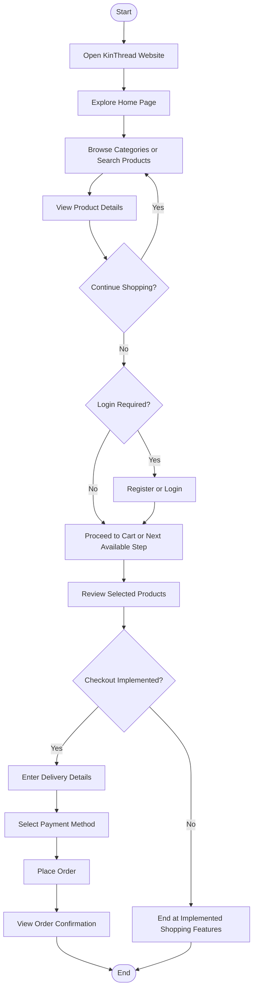
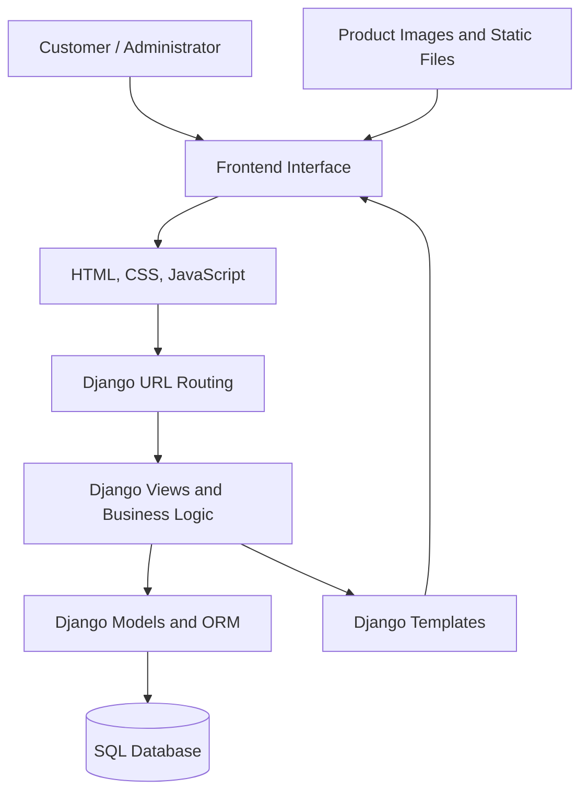

# 👗 KinThread — Fashion E-Commerce Website

**A web-based fashion shopping platform for browsing products, managing shopping carts, and enjoying a convenient online shopping experience.**

[](https://www.python.org/)
[](https://www.djangoproject.com/)
[](https://developer.mozilla.org/)
[](https://www.sqlite.org/)

## 📋 Table of Contents

1. [Project Overview](#-project-overview)
2. [Problem Statement](#-problem-statement)
3. [Project Objectives](#-project-objectives)
4. [Key Features](#-key-features)
5. [Shopping Categories](#-shopping-categories)
6. [System Workflow](#-system-workflow)
7. [System Architecture](#-system-architecture)
8. [Technology Stack](#-technology-stack)
9. [Project Structure](#-project-structure)
10. [Installation and Setup](#-installation-and-setup)
11. [Application Workflow](#-application-workflow)
12. [Testing](#-testing)
13. [Deployment](#-deployment)
14. [Screenshots](#-screenshots)
15. [Future Enhancements](#-future-enhancements)
16. [Learning Outcomes](#-learning-outcomes)
17. [Author](#-author)

---

## 📖 Project Overview

KinThread is a fashion e-commerce web application developed to provide users with a convenient platform for exploring and shopping for fashion products online.

The website is designed around product discovery, category-based browsing, and a user-friendly shopping interface. The intended product categories include men's fashion, women's fashion, kids' fashion, beauty, and accessories.

The application uses Python and Django for backend development, HTML, CSS, and JavaScript for the user interface, and a SQL database for data management. The exact database and implemented features should match the project configuration.

## ❓ Problem Statement

Traditional shopping often requires customers to visit multiple physical stores to compare products, styles, and prices. Customers may also find it difficult to discover products across different fashion categories in one place.

KinThread aims to address these challenges by providing a centralized online platform where customers can browse available products and manage their shopping activities through a web interface.

## 🎯 Project Objectives

- 👗 Provide a centralized platform for fashion products.
- 🔎 Make product discovery and category navigation convenient.
- 🛒 Support shopping cart functionality, if implemented.
- 👤 Provide secure user registration and login, if implemented.
- 📦 Organize product and order information.
- 📱 Deliver a responsive interface across desktop and mobile devices.
- 🛠️ Provide maintainable backend and database integration.
- ☁️ Prepare the application for cloud deployment.

## ✨ Key Features

Document the features available in your actual application.

- 🏠 **Home Page:** Introduces the website and highlights products.
- 🛍️ **Product Catalog:** Displays available fashion products.
- 🗂️ **Category Browsing:** Organizes products into different shopping categories.
- 🔍 **Product Search:** Helps users find products, if implemented.
- 📄 **Product Details:** Displays product information, images, and prices.
- 👤 **User Authentication:** Supports registration and login, if implemented.
- 🛒 **Shopping Cart:** Allows customers to manage selected products, if implemented.
- ❤️ **Wishlist:** Saves favorite products, if implemented.
- 📦 **Order Management:** Supports order placement and tracking, if implemented.
- ⚙️ **Admin Management:** Supports product and inventory management through the configured administration interface.
- 📱 **Responsive Design:** Adapts the interface to different screen sizes, if implemented.

## 🛍️ Shopping Categories

<escape>
| Category | Description |
|---|---|
| 👔 Men's Fashion | Clothing and style products for men |
| 👗 Women's Fashion | Fashion products for women |
| 🧒 Kids' Fashion | Clothing and accessories for children |
| 💄 Beauty | Beauty and personal-care products |
| 👜 Accessories | Accessories that complement different styles |
</escape>

These are the planned or intended categories. Keep only the categories available in the website.

## 🔄 System Workflow

The following diagram illustrates the intended customer shopping workflow. Remove or modify steps that your application does not yet support.



**Workflow explanation:**

1. **Website access:** The customer opens the KinThread home page.
2. **Product discovery:** The customer browses categories or searches for products.
3. **Product selection:** The customer opens a product to view its details.
4. **Authentication:** The customer registers or logs in if the selected action requires authentication.
5. **Cart management:** The customer reviews selected products and updates quantities.
6. **Checkout:** If implemented, the customer provides delivery details and completes the available checkout steps.
7. **Order confirmation:** If order placement is implemented, the website records the order and displays its status.

## 🏗️ System Architecture

KinThread follows a Django-based web application architecture.



**Architecture components:**

- **Presentation layer:** Displays pages, product information, forms, and navigation.
- **Routing layer:** Maps incoming requests to the relevant Django views.
- **Application layer:** Processes user requests and applies business rules.
- **Data layer:** Uses Django models and the ORM to interact with the configured database.
- **Static and media files:** Provide CSS, JavaScript, product images, and other assets.

## 🛠️ Technology Stack

| Layer | Technology | Purpose |
|---|---|---|
| Frontend | HTML5 | Page structure |
| Styling | CSS3 | Layout and visual design |
| Interactivity | JavaScript | Client-side interactions |
| Backend | Python, Django | Application logic and request handling |
| Database | Configured SQL database | Store application data |
| Version Control | Git | Track source-code changes |
| Repository | GitHub | Host and manage source code |
| Deployment | Render, if configured | Host the web application |

## 📂 Project Structure

The following is an illustrative Django project structure. Replace it with the actual folders and filenames in the KinThread repository.

```text
KinThread/
├── manage.py
├── requirements.txt
├── README.md
├── .gitignore
├── .env.example
├── build.sh
├── config/
│   ├── __init__.py
│   ├── settings.py
│   ├── urls.py
│   ├── asgi.py
│   └── wsgi.py
├── store/
│   ├── models.py
│   ├── views.py
│   ├── urls.py
│   ├── forms.py
│   ├── admin.py
│   └── templates/
├── templates/
├── static/
│   ├── css/
│   ├── js/
│   └── images/
└── media/
```

**Important files:**

- `manage.py` — Runs Django management commands.
- `settings.py` — Contains Django application settings.
- `urls.py` — Defines URL routing.
- `models.py` — Defines database models.
- `views.py` — Processes requests and prepares responses.
- `templates/` — Contains HTML templates.
- `static/` — Contains CSS, JavaScript, and static images.
- `requirements.txt` — Lists Python dependencies.
- `build.sh` — Contains deployment build commands, if used.

## ⚙️ Installation and Setup

### Prerequisites

- Python version compatible with your dependencies
- Git
- VS Code or another code editor

### Step 1: Clone the repository

```bash
git clone YOUR_KINTHREAD_GITHUB_REPOSITORY_URL
cd YOUR_KINTHREAD_PROJECT_FOLDER
```

Replace the placeholders with your actual repository URL and folder name.

### Step 2: Create a virtual environment

```bash
python -m venv venv
```

Activate it on Windows:

```bash
venv\Scripts\activate
```

### Step 3: Install dependencies

```bash
pip install -r requirements.txt
```

### Step 4: Apply migrations

```bash
python manage.py migrate
```

### Step 5: Create an administrator account (optional)

```bash
python manage.py createsuperuser
```

### Step 6: Run the development server

```bash
python manage.py runserver
```

Open `http://127.0.0.1:8000/` in your browser.

Run these commands from the directory containing `manage.py`. If the repository uses a different layout, adjust the commands accordingly.

## 🔐 Environment Configuration

For production, keep sensitive configuration in environment variables rather than committing secrets to GitHub.

Typical settings include:

- `SECRET_KEY` — A private Django secret key.
- `DEBUG` — Set to `False` in production.
- `ALLOWED_HOSTS` — The deployed domain and permitted hostnames.
- `DATABASE_URL` — Database connection string, if supported by the project.
- `CSRF_TRUSTED_ORIGINS` — Trusted HTTPS origins, when required.

Use the environment-variable names expected by your actual Django settings.

## 🛒 Application Workflow

### Customer workflow

1. Open the home page.
2. Browse products and available categories.
3. Select a product to view its details.
4. Log in or register when required.
5. Add products to the cart, if available.
6. Review the cart and proceed through checkout, if available.
7. View order confirmation and status, if implemented.

### Administrator workflow

1. Log in to the configured administration interface.
2. Add or update product information.
3. Manage product categories and prices, if supported.
4. Update inventory and product availability, if implemented.
5. Review and manage orders, if the project includes order management.

## 🧪 Testing

Run the Django tests available in the project:

```bash
python manage.py test
```

Before publishing test results, confirm that the tests actually run and pass. Test authentication, product pages, database operations, cart behavior, order processing, and permissions where applicable.

## ☁️ Deployment

KinThread can be deployed to a platform such as Render if the project is configured for production.

### Deployment checklist

1. Push the latest working code to GitHub.
2. Confirm that dependencies are listed in `requirements.txt`.
3. Configure production settings and environment variables.
4. Configure static-file collection and serving.
5. Configure a persistent database, such as PostgreSQL, if required.
6. Configure uploaded media storage for product images.
7. Create a Render Web Service and connect the repository.
8. Set the correct build and start commands for the Django project.
9. Run migrations and verify the deployment logs.
10. Test the live website, including product pages, login, images, and any implemented cart or checkout functionality.

Do not publish secrets in the repository. A successful GitHub push does not mean the website has been deployed.

## 📸 Screenshots

Create a `screenshots/` folder and add real screenshots of your application.

Suggested screenshots:

- Home page
- Product listing page
- Product detail page
- Category page
- Login and registration pages
- Shopping cart
- Checkout or order page, if implemented
- Administration interface, if appropriate

Example Markdown for an image stored at `screenshots/home.png`:

```markdown

```

## 🔮 Future Enhancements

Potential improvements include:

- 💳 Secure payment gateway integration.
- 📦 Order tracking and delivery updates.
- ⭐ Product reviews and ratings.
- 🔔 Order and stock notifications.
- 🎯 Personalized product recommendations.
- ☁️ Production monitoring and improved media storage.
- 📱 Further mobile usability improvements.

List these as future enhancements only when they are not already implemented.

## 🎓 Learning Outcomes

This project can demonstrate practical experience in:

- Full-stack web application development.
- Django request handling and application architecture.
- Database integration and data modeling.
- Frontend development and user-interface design.
- Git and GitHub version control.
- Application testing, debugging, and deployment preparation.

## 👩‍💻 Author

**KinThread Project Developer**

- GitHub: [gayathriappalreddy23-afk](https://github.com/gayathriappalreddy23-afk)

---

⭐ Thank you for exploring KinThread!
